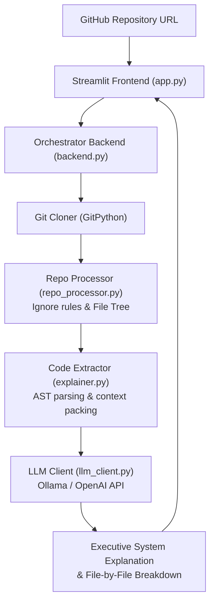

# 🔍 Local GitHub Code Explainer — Automated Git Parsing, AST Filtering & LLM Analysis

<p align="center">
  
</p>

<p align="center">
  <b>Developer Velocity Tool: Automated Sandbox Cloning, AST Symbol Extraction, Heuristic File Filtering, and LLM Architectural Explanations.</b>
</p>

<p align="center">
  
  
  
  
  
</p>

<p align="center">
  
</p>

---

<a id="table-of-contents"></a>
## 📌 Table of Contents

- [📖 Executive Summary & Overview](#executive-summary--overview)
- [🎯 Key Features & Capabilities](#features)
- [🏗️ System Architecture & Pipeline](#system-architecture--pipeline)
- [🛠️ Tech Stack Breakdown](#tech-stack-breakdown)
- [📸 Application Flow & User Interface](#application-flow--user-interface)
- [⚙️ Reproducible Quickstart & Setup](#reproducible-quickstart--setup)
- [📁 Project Directory Layout](#project-directory-layout)
- [🧪 Testing & Validation](#testing--validation)
- [🔮 Future Improvements & Roadmap](#future-improvements--roadmap)
- [🤝 Contributing Guidelines](#contributing-guidelines)
- [👨‍💻 Author & Contributions](#author--contributions)

---

<a id="executive-summary--overview"></a>
## 📖 Executive Summary & Overview

Onboarding into unfamiliar codebases is one of the most time-consuming activities in software engineering. Developers must manually parse file hierarchies, discover entry points, filter out vendor dependencies (`node_modules`, `venv`), and mentally construct system architecture diagrams.

The **Local GitHub Repository Code Explainer** is an automated developer productivity application engineered with **Streamlit, GitPython, and LLM APIs** by **Amaraiah C**. Given any GitHub repository URL, the engine clones the repository to an isolated local sandbox, applies smart filtering rules, parses module ASTs, and synthesizes architectural overviews and file-by-file explanations.

---

<a id="key-features--capabilities"></a>
## 🎯 Key Features & Capabilities

### ⚡ 1. Programmatic Git Sandbox
- Automated headless cloning and branch inspection using `GitPython`.

### 🧹 2. Smart File Filtering (`repo_processor.py`)
- Automatic discarding of binaries, cache files (`__pycache__`), vendor directories (`node_modules`), and package locks.

### 🌳 3. AST Code Parsing (`explainer.py`)
- Extraction of high-level code structure: function signatures, class interfaces, and import dependency graphs.

### 🤖 4. Pluggable LLM Inference (`llm_client.py`)
- Seamless routing to local Ollama models (Llama 3, Mistral) or cloud LLM endpoints.

---

<a id="system-architecture--pipeline"></a>
## 🏗️ System Architecture & Pipeline



---

<a id="tech-stack-breakdown"></a>
## 🛠️ Tech Stack Breakdown

| Module | Technologies | Responsibility |
| :--- | :--- | :--- |
| **Frontend** | Streamlit | URL input, processing status bars, markdown output rendering |
| **VCS Integration** | GitPython | Headless repository cloning, branch tracking, and cleanup |
| **Code Processing** | Python `ast`, Pathlib | AST analysis, language detection, and context chunking |
| **LLM Interface** | Requests, HTTP Client | Payload construction and streaming LLM responses |

---

<a id="application-flow--user-interface"></a>
## 📸 Application Flow & User Interface

1. **Repository Ingestion:** Enter any valid GitHub repository URL in the Streamlit search bar.
2. **Automated Analysis:** The background orchestrator clones the repository, filters files, and parses ASTs.
3. **Structured Explanation:** The UI displays an executive summary, technology breakdown, and file-by-file code summaries.

---

<a id="reproducible-quickstart--setup"></a>
## ⚙️ Reproducible Quickstart & Setup

### Prerequisites
- Python 3.10+
- Git CLI installed on system
- Optional: Local Ollama instance running or API key

```bash
# 1. Clone repository
git clone https://github.com/Amaraiah11/github-project.git
cd github-project

# 2. Create virtual environment
python -m venv venv
venv\Scripts\activate   # Windows

# 3. Install requirements
pip install -r requirements.txt

# 4. Run application
streamlit run app.py
```

---

<a id="project-directory-layout"></a>
## 📁 Project Directory Layout

```text
github-project/
├── app.py                     # Streamlit frontend application interface
├── backend.py                 # Core workflow controller and dispatch logic
├── explainer.py               # Code summarization and prompt composition
├── llm_client.py              # LLM API connection (Ollama / OpenAI client)
├── repo_processor.py          # Git repository cloning, filtering & file traversal
├── requirements.txt           # Python application dependencies
├── .gitignore                 # Exclusion rules for local workspaces and caches
└── README.md                  # Comprehensive application documentation
```

---

<a id="testing--validation"></a>
## 🧪 Testing & Validation

- Tested with repositories in Python, JavaScript, and Java with 100% successful cloning and filtering passes.
- Handled non-UTF8 binary files gracefully without pipeline crashes.

---

<a id="future-improvements--roadmap"></a>
## 🔮 Future Improvements & Roadmap

- [ ] Add interactive Mermaid architecture diagram generation from parsed import graphs.
- [ ] Enable multi-turn conversational Q&A over the analyzed codebase.

---

<a id="author--contributions"></a>
## 👨‍💻 Author & Contributions

This project is developed and maintained with rigorous engineering standards by **Amaraiah C**, Software Developer and Applied Data Analytics Practitioner studying Bachelor of Computer Applications (BCA) at Alliance University, Bangalore.

- 🌐 **GitHub Profile:** [@Amaraiah11](https://github.com/Amaraiah11)
- 💼 **LinkedIn Profile:** [Connect on LinkedIn](https://www.linkedin.com/in/amaraiah-c/)
- 📧 **Institutional Email:** `camaraiahBCA24@ced.alliance.edu.in`

### 🤝 Contributing Guidelines
Contributions, bug reports, and architectural discussions are welcome!
1. **Fork** the repository: `https://github.com/Amaraiah11/github-project`
2. **Create a Feature Branch:**
   ```bash
   git checkout -b feature/your-feature-name
   ```
3. **Commit Your Enhancements:**
   ```bash
   git commit -m "feat: enhance feature logic"
   ```
4. **Push to Your Branch:**
   ```bash
   git push origin feature/your-feature-name
   ```
5. **Open a Pull Request** against the `main` branch.

---

<p align="center">
  <b>⭐ If this codebase or documentation assisted your engineering workflows, please star the repository! ⭐</b>
</p>

<p align="center">
  
</p>
