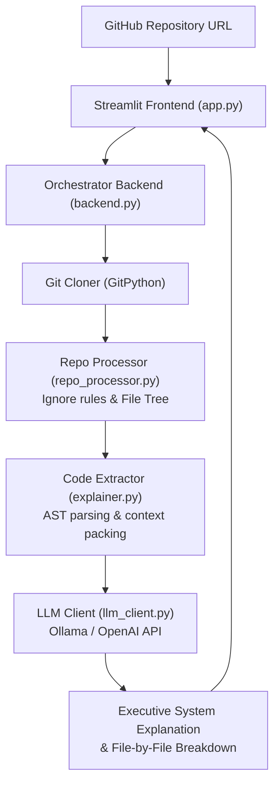

<p align="center">
  
</p>

<p align="center">
  
  
  
  
  
</p>

<a id="overview"></a>
## 📖 Executive Summary & Overview

Onboarding into unfamiliar codebases is one of the most time-consuming engineering activities. Developers must manually trace dependencies, understand entry points, and construct mental models of architectural flow.

The **Local GitHub Repository Code Explainer** is an end-to-end Python tool built on **Streamlit, GitPython, and LLM APIs (Ollama / OpenAI-compatible)**. Given any GitHub repository URL, the engine clones the repository to an isolated local sandbox, applies intelligent file filtering to discard binary and vendor clutter, extracts project structure and key code modules, and synthesizes architectural explanations and file-by-file walkthroughs.

<a id="toc"></a>
## 📑 Table of Contents

- [📖 Executive Summary & Overview](#overview)
- [🎯 Key Features & Capabilities](#features)
- [🏗️ System Architecture & Pipeline](#architecture)
- [🛠️ Tech Stack Breakdown](#tech-stack)
- [⚙️ Reproducible Quickstart & Setup](#setup)
- [📁 Project Directory Layout](#project-layout)
- [👨‍💻 Author & Contributions](#author)

<a id="features"></a>
## 🎯 Key Features & Capabilities

- **Automated Sandbox Cloning:** Programmatic repository cloning and branch management powered by `GitPython`.
- **Heuristic File Filtering:** Smart exclusion rules filtering out `.git/`, `node_modules/`, `__pycache__/`, binaries, and minified bundles.
- **AST & Symbol Extraction:** Code summarization highlighting classes, function definitions, and package imports.
- **Pluggable LLM Inference:** Seamless integration with local Ollama models (Llama 3, Mistral) or cloud LLM endpoints.
- **Interactive Streamlit Interface:** Real-time progress indicators, file trees, and markdown-formatted architectural breakdowns.

<a id="architecture"></a>
## 🏗️ System Architecture & Pipeline



<a id="tech-stack"></a>
## 🛠️ Tech Stack Breakdown

| Module | Technologies | Responsibility |
| :--- | :--- | :--- |
| **Frontend** | Streamlit | Clean UI for URL input, progress bars, and markdown rendering |
| **VCS Integration** | GitPython | Headless repository cloning, branch checkout, and cleanup |
| **Code Processing** | Python `ast`, Pathlib | AST analysis, language detection, and context chunking |
| **LLM Interface** | Requests, HTTP Client | Payload construction and streaming LLM responses |

<a id="setup"></a>
## ⚙️ Reproducible Quickstart & Setup

### Prerequisites
- Python 3.10+
- Git CLI installed on system
- Optional: Local Ollama instance running or API key

```bash
# 1. Clone repository
git clone https://github.com/Amaraiah11/github-project.git
cd github-project

# 2. Create virtual environment
python -m venv venv
venv\Scripts\activate   # Windows

# 3. Install requirements
pip install -r requirements.txt

# 4. Run application
streamlit run app.py
```

<a id="project-layout"></a>
## 📁 Project Directory Layout

```text
github-project/
├── app.py                     # Streamlit frontend application interface
├── backend.py                 # Core workflow controller and dispatch logic
├── explainer.py               # Code summarization and prompt composition
├── llm_client.py              # LLM API connection (Ollama / OpenAI client)
├── repo_processor.py          # Git repository cloning, filtering & file traversal
├── requirements.txt           # Python application dependencies
├── .gitignore                 # Exclusion rules for local workspaces and caches
└── README.md                  # Comprehensive application documentation
```

<a id="author"></a>
## 👨‍💻 Author & Contributions

This project is developed and maintained with high technical rigour by **Amaraiah C**, Software Engineer and Data Analytics Practitioner studying Bachelor of Computer Applications (BCA) at Alliance University.

- 🌐 **GitHub:** [@Amaraiah11](https://github.com/Amaraiah11)
- 💼 **LinkedIn:** [Connect on LinkedIn](https://www.linkedin.com/in/amaraiah-c/)
- 📧 **Institutional Contact:** `camaraiahBCA24@ced.alliance.edu.in`

### 🤝 Contribution Guidelines
Contributions, bug reports, and architectural discussions are welcome!
1. **Fork** the repository: `https://github.com/Amaraiah11/github-project`
2. **Branch**: `git checkout -b feature/your-feature-name`
3. **Commit**: `git commit -m "feat: enhance feature logic"`
4. **Push**: `git push origin feature/your-feature-name`
5. **Open Pull Request** against the `main` branch.

---

<p align="center">
  <b>⭐ If this codebase or documentation assisted your engineering workflows, please star the repository! ⭐</b>
</p>

<p align="center">
  
</p>
